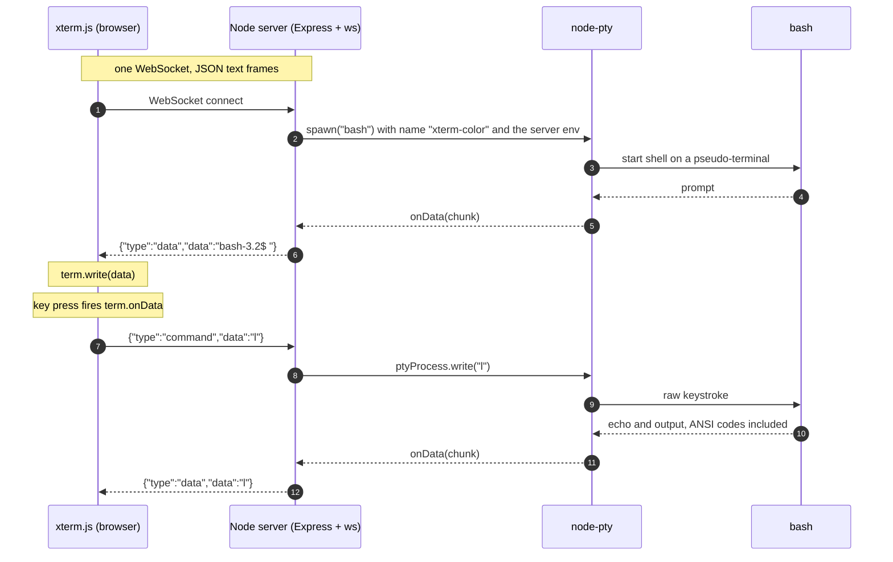

# browser-terminal

A real bash shell in a browser tab, in about 150 lines of TypeScript. xterm.js runs in a Next.js page and talks over a single WebSocket to a Node server that spawns one pseudo-terminal per connection with node-pty. It is the core loop behind the terminals in browser IDEs and cloud shells.

> [!CAUTION]
> Demo code, not a deployable service. Starting the API gives an **unauthenticated shell on your machine** to anyone who can reach its port, and that includes any web page open in your browser. Stop it when you are done. See [Security](#security).

[](https://www.youtube.com/watch?v=0lK4lqzT-fI)

Video walkthrough: [How to create a Terminal inside your browser](https://www.youtube.com/watch?v=0lK4lqzT-fI)

## How it works

Every WebSocket connection gets its own `bash` process attached to a pseudo-terminal (80x24, `TERM=xterm-color`). Key presses travel up, raw terminal output travels down, and xterm.js renders the ANSI stream. The entire protocol is two JSON text frames:

| Direction | Frame | What happens |
| --- | --- | --- |
| browser to server | `{"type":"command","data":"<keystrokes>"}` | `ptyProcess.write(data)`. One frame per input event (a key press, or a whole paste), Enter is `"\r"`. Frames that are not valid JSON, or have any other `type`, are ignored. |
| server to browser | `{"type":"data","data":"<raw pty output>"}` | `term.write(data)`. ANSI codes and CRLF included, chunk boundaries are arbitrary. |



The shell echoes what you type, which is why the character you pressed comes back as a `data` frame before any command output does. The frame contents in the diagram are examples: the prompt depends on the bash version and startup files on the server, and newer bash versions (5.3 in testing) put a bracketed-paste escape sequence (`\x1b[?2004h`) in front of it.

## Tech stack

- **Web:** Next.js 14 (app router), React 18, `@xterm/xterm` 5.5
- **API:** Node.js, Express 4, `ws` 8, `node-pty` 1.0, bundled to a single file with tsup
- **Tooling:** TypeScript, pnpm 9 workspaces, Turborepo 1.13

## Prerequisites

- **Node.js 22** (tested with 22.16.0 and 22.23.3), pinned in `.nvmrc`. `package.json` says `>=18`, but Node 24 cannot compile node-pty 1.0.0. Other versions are untested.
- **pnpm 9.0.6.** It is pinned through `packageManager` in the root `package.json`, so with Corepack enabled `pnpm` resolves to that version inside the repo.
- **A C/C++ toolchain, `make` and Python 3.** node-pty is compiled from source during install. Tested on macOS (Apple Silicon) with the Xcode Command Line Tools.
- **`bash` on the `PATH`** of the machine that runs the API.

## Getting started

```sh
git clone https://github.com/spiritanand/browser-terminal.git
cd browser-terminal
nvm install && nvm use         # reads .nvmrc; or: fnm install && fnm use
corepack enable                # pnpm now resolves to the pinned 9.0.6 inside the repo
pnpm install                   # compiles node-pty from source
```

If `pnpm install` ends in a wall of C++ errors from `node-pty`, followed by `gyp ERR! build error` and `ELIFECYCLE Command failed with exit code 1`, check `node --version`. Node 24 fails exactly this way.

The client connects to `ws://localhost:5001`. To point it elsewhere, set `NEXT_PUBLIC_WS_URL` for the web app, on the command line or in `apps/web/.env.local`. Next.js inlines it at build time, so restart `next dev` or rebuild after changing it.

> [!WARNING]
> The first command below starts the unauthenticated shell server. Read [Security](#security) before you run it.

Start the two apps, each in its own terminal.

Terminal 1, the API (Express + WebSocket server on `127.0.0.1:5001`). Wait for `api running on 127.0.0.1:5001`:

```sh
pnpm --filter api dev
```

Terminal 2, the web app (Next.js on <http://localhost:3000>). Wait for `Ready in`:

```sh
pnpm --filter web dev
```

Stop both with Ctrl+C. Each `bash` ends when its tab closes or the API exits, and typing `exit` closes the connection.

Open <http://localhost:3000>. A black terminal box with a `bash` prompt appears (for example `bash-3.2$`, it depends on the bash the server finds). Click inside the box, then type: nothing is focused on load, so key presses before the click are ignored. A black box with no prompt usually means the WebSocket did not connect. Check that the API is running and that `NEXT_PUBLIC_WS_URL`, if you set it, matches its port; the error shows up only in the browser console.

`curl http://localhost:5001/status` returns `{"ok":true}` when the API is up. To test the shell path without a browser (Node 22 has a built-in `WebSocket`):

```sh
node -e 'const ws=new WebSocket("ws://localhost:5001");ws.onmessage=(e)=>console.log(e.data);ws.onopen=()=>setTimeout(()=>ws.send(JSON.stringify({type:"command",data:"echo hello && exit\r"})),500);setTimeout(()=>process.exit(0),2000)'
```

It should print a prompt frame, the echoed command, and a frame containing `hello`. The trailing `exit` ends the shell, so the check leaves no `bash` process behind.

Both apps read `PORT`. Set it per command rather than exporting it, because an exported `PORT` would apply to both apps at once. If you move the API (`PORT=5187 pnpm --filter api dev`), start the web app with the matching URL (`NEXT_PUBLIC_WS_URL=ws://localhost:5187 pnpm --filter web dev`), otherwise the page shows an empty terminal. The API binds to `127.0.0.1`; `HOST=0.0.0.0` exposes it, and with it a shell, to your whole network.

At the root, `pnpm build` and `pnpm typecheck` pass. `pnpm lint` and `pnpm test` do not yet (see the roadmap).

## Project structure

```text
apps/
  api/
    src/index.ts                     HTTP + WebSocket server, one bash PTY per connection
    src/server.ts                    Express app: GET /status, plus a leftover GET /message/:name
    Dockerfile                       does not build yet, see the roadmap
  web/
    app/page.tsx                     renders the terminal
    components/xterminal/index.tsx   xterm.js instance, WebSocket client, input handler
packages/                            starter leftovers, not imported by either app
```

The repo was scaffolded from the Turborepo kitchen-sink starter. Neither app imports anything from `packages/` (`@repo/ui`, `@repo/logger`, `@repo/jest-presets`, `@repo/eslint-config`, `@repo/typescript-config`), although `pnpm build` still builds `ui` and `logger`. The one remaining link is the Jest preset `@repo/jest-presets/node` named in `apps/api/package.json`; it is not a declared dependency and only resolves through pnpm hoisting. Tailwind is configured in `apps/web` but no utility classes are used.

## Security

> [!CAUTION]
> The API hands an **unauthenticated interactive shell** to anyone who can open a WebSocket to it. Do not deploy it publicly as is.

- The shell runs as the user who started the server and inherits its whole environment (`env: process.env`), secrets included.
- There is no authentication and no `Origin` check, and CORS is wide open, so a web page you visit could connect to an instance running on your machine.
- It binds to `127.0.0.1` unless `HOST` is set. That keeps other machines out, not other web pages: see the previous point.

Run it only on a machine and network you trust, preferably inside a throwaway VM or container, and stop it when you are done.

## Known limitations and roadmap

- [ ] **Auth.** Add authentication and an `Origin` allow-list.
- [ ] **Resize.** The PTY is fixed at 80x24 and xterm.js renders a fixed-size box. There is no fit addon and no resize message, so full-screen programs such as vim are laid out for 80x24.
- [ ] **Reconnect.** There is none: when the shell exits or the API restarts, the terminal stops responding until you reload the page.
- [ ] **Docker.** `docker build apps/api` fails at `pnpm install`: Corepack in `node:21.7.3` downloads a pnpm release it cannot run, because `apps/api/package.json` has no `packageManager` field. The image also never runs a build, so `dist/` is only there if you built locally first (`.dockerignore` excludes just `node_modules`, so `COPY . .` picks up a local `dist/`).
- [ ] **Repo hygiene.** Tighten `engines` to match Node 22, remove the starter packages (together with the `@repo/jest-presets/node` Jest preset that `apps/api/package.json` still points at), and make `pnpm lint` and `pnpm test` pass (empty `apps/api/.eslintrc.js`, no API tests).

This is a small demo that accompanies the video above, not production software. Issues and pull requests are welcome.
